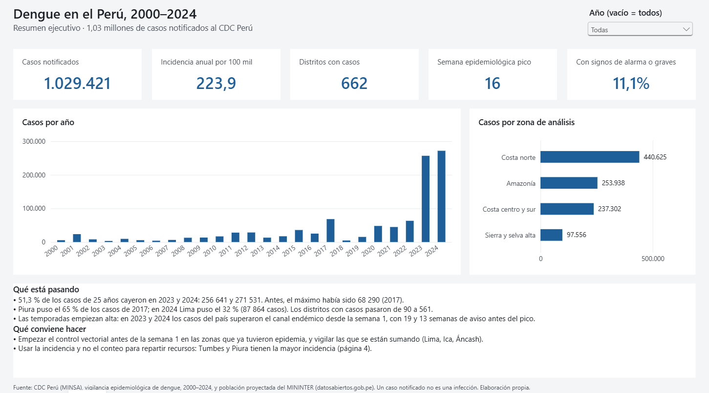
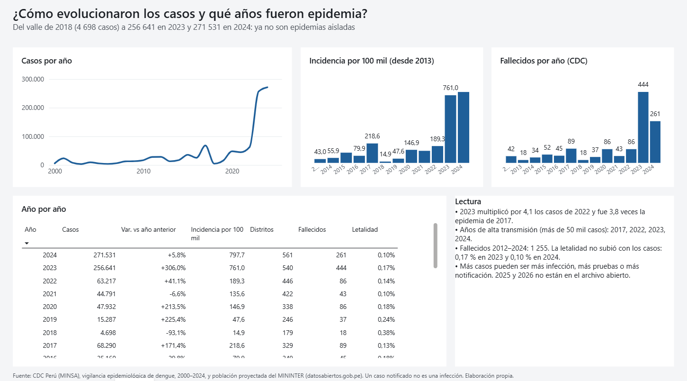
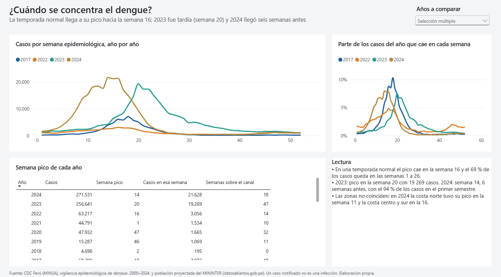
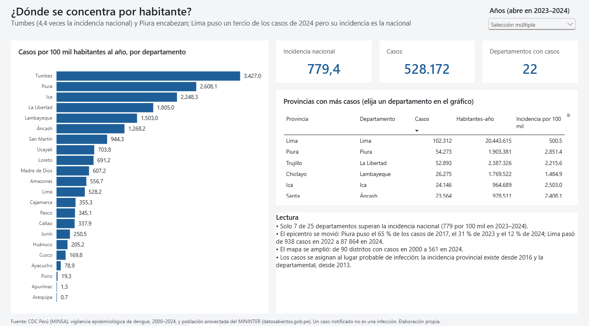
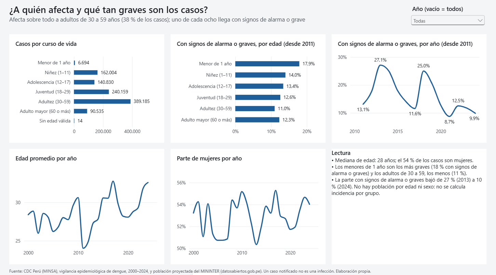
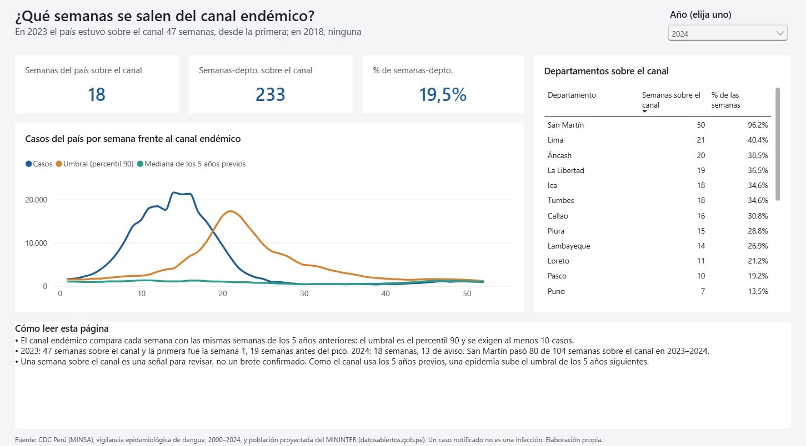
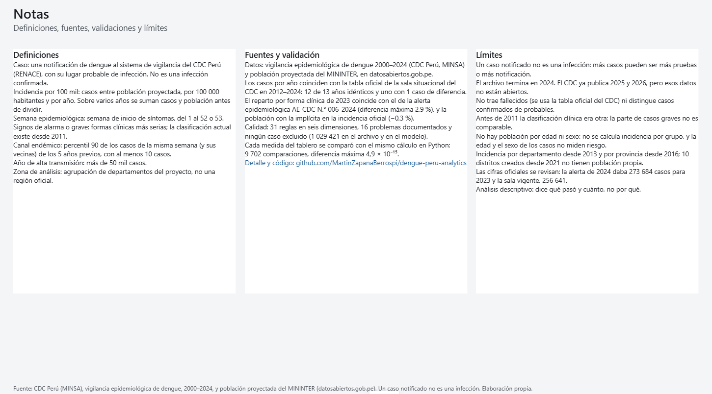

# Dengue Perú Analytics

[](https://github.com/MartinZapanaBerrospi/dengue-peru-analytics/actions/workflows/ci.yml)
[-C8102E)](https://www.datosabiertos.gob.pe/dataset/vigilancia-epidemiol%C3%B3gica-de-dengue)
[](powerbi/)
[](src/)
[](LICENSE)

Análisis de la **vigilancia epidemiológica del dengue en el Perú**: 1,03 millones de casos notificados entre 2000 y
2024 al CDC Perú. Se hizo de punta a punta con **datos abiertos reales** del Ministerio de Salud, desde un CSV de
108 MB hasta un tablero de Power BI para gerencia.

**[Ver el tablero en Power BI →](https://app.powerbi.com/view?r=eyJrIjoiNDRmNGU1YjctNTRjYi00MjM4LWI0MjYtYTRlY2I1NTljMDM5IiwidCI6IjFlYmE0NDNmLTIzZTUtNDUzNC05MGQxLTA5NzZhYWJlODZhYyIsImMiOjR9&pageName=p1_resumen)**



## La pregunta

¿Cómo se comportó el dengue en el Perú entre 2000 y 2024: cuándo golpean las epidemias, dónde se concentran por
habitante, a quién afectan y qué tan graves son los casos?

**Para quién es el tablero.** Para el área de epidemiología de una dirección regional de salud o un analista del
Ministerio de Salud, que prepara el plan de control vectorial y reparte personal y camas antes de la temporada.

**Una advertencia antes de leer.** Un caso notificado no es una infección: es lo que el sistema de vigilancia detectó
y registró. Más casos pueden ser más infección, más pruebas o más notificación. El proyecto es descriptivo y **no
estima causas** (clima, El Niño, serotipos, urbanización); cada hallazgo dice qué mide y qué no.

## Hallazgos

Datos hasta diciembre de 2024. La incidencia es casos por 100 mil habitantes en un año, con población proyectada del
MININTER.

1. **2023 y 2024 concentran la mitad de los casos de 25 años.** Fueron 256 641 y 271 531 de 1 029 421 (51,3 %). 2023
   multiplicó por 4,1 los casos de 2022 y fue 3,8 veces la epidemia de 2017 (68 290). La incidencia pasó de 14,9 en el
   valle de 2018 a 761 en 2023 y 798 en 2024.
2. **La temporada normal llega a su pico hacia la semana 16, pero 2023 y 2024 la rompieron.** 2023 llegó a la semana 20
   (19 269 casos en una semana); 2024, a la 14 (21 628), seis semanas antes, con el 94 % de sus casos en el primer
   semestre.
3. **Tumbes y Piura tienen la mayor incidencia.** En 2023–2024, Tumbes: 3 427 por 100 mil, 4,4 veces la nacional (779);
   Piura: 2 608 e Ica: 2 248. Solo 7 de 25 departamentos superan la nacional.
4. **El epicentro se movió y el mapa se amplió.** Piura puso el 65 % de los casos de 2017, el 31 % de 2023 y el 12 % de
   2024. **Lima pasó de 938 casos en 2022 a 87 864 en 2024**, un tercio del país. Los distritos con casos pasaron de
   90 (2000) a 561 (2024) y los departamentos, de 11 a 22.
5. **Afecta sobre todo a adultos de 30 a 59 años (38 %), y el 54 % de los casos son mujeres.** La mediana de edad es de
   28 años. La fuente no trae población por edad ni sexo, así que esto no es riesgo, sino composición de los casos.
6. **Uno de cada ocho casos llega con signos de alarma o grave, y esa parte bajó.** Fue 27,1 % en 2013 y 9,9 % en 2024.
   Los menores de 1 año son los más graves (17,9 %). El CDC registra 1 255 fallecidos entre 2012 y 2024; la letalidad
   de 2023 fue de 0,17 % y la de 2024, de 0,10 %.
7. **En 2023 y 2024 el canal endémico estaba sobrepasado desde la semana 1.** El país estuvo sobre el canal 47 semanas
   en 2023 (19 antes del pico) y 18 en 2024 (13 antes del pico); en 2018, ninguna. San Martín pasó 80 de 104 semanas
   sobre el canal en 2023–2024.

## El tablero

Siete páginas, una por pregunta: el título es la pregunta, el subtítulo es la respuesta y debajo hay la evidencia, una
lectura para gerencia y la fuente.

| | |
|---|---|
|  **2. Epidemias.** Casos, incidencia y fallecidos por año. |  **3. Temporada.** Curva semanal de los años que se elijan y semana pico. |
|  **4. Territorio.** Incidencia por departamento y provincias con más casos. |  **5. Pacientes.** Edad, sexo y gravedad. |
|  **6. Brotes.** Casos del país frente al canal endémico. |  **7. Notas.** Definiciones, fuentes, validaciones y límites. |

El detalle de las páginas, el diseño y cómo abrirlo está en [`powerbi/README.md`](powerbi/README.md).

## Glosario

- **CDC Perú.** Centro Nacional de Epidemiología, Prevención y Control de Enfermedades, del Ministerio de Salud.
- **Semana epidemiológica.** Semana del año de inicio de los síntomas, del 1 al 52 o 53.
- **Incidencia por 100 mil.** Casos entre población, por 100 000 habitantes y por año. Sobre varios años se suman casos y
  población antes de dividir; nunca se promedian tasas.
- **Signos de alarma o grave.** Las formas clínicas más serias; la clasificación actual existe desde 2011.
- **Canal endémico.** Lo normal para cada semana, según los 5 años previos (aquí, el percentil 90 con al menos 10
  casos). Una semana por encima es una señal para revisar, no un brote confirmado.
- **Año de alta transmisión.** Más de 50 mil casos: 2017, 2022, 2023 y 2024.
- **UBIGEO.** Código de seis dígitos de cada distrito; aquí, el de infección probable.

## Cómo se construyó

| Fase | Qué se hizo | Documento |
|---|---|---|
| 0. Definición | Pregunta, usuario, indicadores y reconocimiento de las fuentes probado contra el portal y el CDC | [00_definicion.md](docs/00_definicion.md) |
| 1. Adquisición | Descarga desde el navegador y manifiesto con hash SHA-256 de cada archivo | [01_adquisicion.md](docs/01_adquisicion.md) |
| 2. Calidad | Perfilado, 31 reglas en seis dimensiones, 16 problemas catalogados y 4 validaciones | [02_calidad.md](docs/02_calidad.md) |
| 3. Transformación | raw → staging → modelo en estrella agregado (1 029 421 casos en 332 850 filas), con canal endémico y linaje | [03_transformacion.md](docs/03_transformacion.md) |
| 4. Modelado | Modelo de Power BI en TMDL con 38 medidas validadas contra Python | [04_modelado.md](docs/04_modelado.md) |
| 5. Análisis | Respuestas a P1–P6 con cifras y advertencias | [05_analisis.md](docs/05_analisis.md) |
| 6. Tablero | Informe de 7 páginas en PBIR, generado por script | [powerbi/README.md](powerbi/README.md) |
| 7–8. Hallazgos y pruebas | Este README y 52 pruebas en GitHub Actions | [`.github/workflows/ci.yml`](.github/workflows/ci.yml) |

**Lo que valida el resultado.**

- **V1.** Los casos por año del archivo coinciden con la tabla oficial de la sala situacional del CDC en 2012–2024:
  12 de 13 años idénticos y uno (2013) con 1 caso de diferencia.
- **V2.** El reparto por forma clínica de 2023 coincide con el de la alerta epidemiológica AE-CDC N.° 006-2024
  (diferencia máxima 2,9 %). El titular de esa alerta, 273 684 casos, difiere 6,2 % del archivo: son cortes distintos
  de una serie que el CDC revisa, y el archivo coincide con la vigente (256 641).
- **V3.** La población usada coincide con la implícita en la incidencia oficial de 2023 (−0,3 %).
- **V4.** La población de los departamentos suma exactamente la nacional en 2013–2024; la de las provincias, desde 2016.
- **Medidas.** Las 38 medidas DAX se compararon con el mismo cálculo en Python: 9 702 comparaciones, diferencia relativa
  máxima de 4,9 × 10⁻¹⁵ (error de punto flotante).
- **Linaje.** Los 1 029 421 casos del archivo están en el modelo: ninguno se excluyó.

## Cómo reproducirlo

El portal responde 418 a los clientes que no son navegadores y este proyecto **no intenta evadirlo**: el CSV de dengue y
el zip de población se bajaron una vez desde el navegador y se registraron en el manifiesto
[`data/raw/manifest.csv`](data/raw/manifest.csv), con su tamaño y hash. El sitio del CDC sí acepta descargas por script:
su sala situacional está en [`docs/fuentes/`](docs/fuentes/).

```bash
pip install -r requirements.txt
# 1. dejar el CSV y el zip del portal en data/raw/descarga/ (ver docs/01_adquisicion.md) y registrarlos
python -m src.extract
# 2. calidad, validaciones, modelo curado y análisis
python -m src.quality
python -m src.validate
python -m src.transform
python -m src.analysis
# 3. pruebas
pytest -q
```

Para **ver solo el tablero** no hace falta ejecutar nada: `data/curated/` viene en el repositorio y `powerbi/dengue.pbip`
se abre y se actualiza directamente (ver [`powerbi/README.md`](powerbi/README.md)).

## Estructura

```
├── src/          extract · parse · quality · validate · transform · analysis
├── data/
│   ├── raw/        manifest.csv (los archivos originales no se versionan)
│   ├── reference/  departamentos, inventario del portal y la tabla oficial de casos y fallecidos del CDC
│   └── curated/    modelo en estrella en CSV, lo que lee Power BI
├── powerbi/      dengue.pbip · modelo (TMDL) · informe (PBIR)
├── tools/        generadores del modelo y del informe, validación de medidas, capturas
├── reports/      validaciones, calidad, linaje y análisis
├── tests/        52 pruebas con recortes de los archivos reales
└── docs/         una página por fase · fuentes/ (PDF oficiales) · img/ capturas del tablero
```

## Limitaciones

- **Un caso notificado no es una infección.** Más casos pueden ser más pruebas o más notificación; la incidencia no mide
  riesgo individual.
- **El archivo abierto termina en 2024.** El CDC ya publica 2025 y 2026 (35 852 y 46 669 casos, hasta la semana 33),
  pero esos datos no están en el conjunto.
- **No trae fallecidos ni distingue confirmados de probables.** Los fallecidos salen de la tabla oficial del CDC; la
  documentación del portal menciona una columna (`tipo_dx`) que el archivo no tiene.
- **La gravedad solo se compara desde 2011.** Antes, la clasificación clínica era otra.
- **No hay población por edad ni sexo:** la edad y el sexo describen los casos, no el riesgo de cada grupo.
- **Incidencia por departamento desde 2013 y por provincia desde 2016;** 10 distritos creados desde 2021 no tienen
  población propia, y las tasas de los departamentos con casi ningún caso (Arequipa, Apurímac, Moquegua) no son
  interpretables.
- **Las cifras oficiales se revisan:** la alerta de 2024 daba 273 684 casos para 2023 y la sala vigente, 256 641. Se
  valida contra una publicación de fecha fija y se cita su corte.
- **El canal endémico depende de los 5 años previos:** una epidemia sube el umbral de los 5 años siguientes.
- **Análisis descriptivo.** Dice qué pasó y cuánto, no por qué.

## Fuentes y licencia

- [Vigilancia epidemiológica de dengue](https://www.datosabiertos.gob.pe/dataset/vigilancia-epidemiol%C3%B3gica-de-dengue)
  (MINSA, CDC Perú), licencia Open Data Commons Attribution.
- [Indicadores de seguridad ciudadana y tendencias territoriales](https://www.datosabiertos.gob.pe/dataset/indicadores-de-seguridad-ciudadana-y-tendencias-territoriales-mininter)
  (MININTER): población proyectada.
- [Sala situacional del dengue, SE 33 de 2026](https://www.dge.gob.pe/portal/docs/vigilancia/sala/2026/SE33/dengue.pdf)
  y [alerta epidemiológica AE-CDC N.° 006-2024](https://cdn.www.gob.pe/uploads/document/file/6024485/5140727-alerta-epidemiologica-n-006-2024-cdc-minsa-dengue-en-el-peru.pdf)
  (CDC Perú): cifras oficiales para validar.

Son estadísticas de vigilancia sin nombres ni documentos de las personas. Código bajo licencia [MIT](LICENSE).
