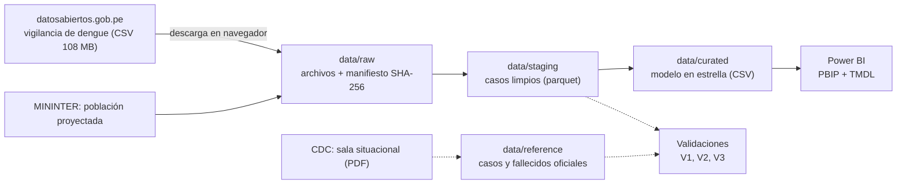

# Fase 0 — Definición del proyecto

> Estado: **cerrada** (2026-10-13). Todo lo que este documento afirma sobre las fuentes se
> comprobó el mismo día contra la Plataforma Nacional de Datos Abiertos y contra la sala
> situacional del CDC Perú, leyendo los archivos completos.

## 1. El problema

El dengue es la enfermedad que más presiona a los servicios de salud del norte y la selva del
Perú, pero casi siempre se discute con una cifra de moda: «récord de casos». Esa cifra esconde lo que
importa para actuar antes de la temporada: **cuándo** empieza y llega al pico cada epidemia, **dónde**
pega más por habitante, **a quién** afecta y **qué tan grave** es lo que se notifica.

Este proyecto usa la vigilancia epidemiológica del CDC Perú (1,03 millones de casos entre 2000 y
2024, uno por fila) para responder esas preguntas, con incidencia por 100 mil habitantes y con la
advertencia de qué mide y qué no mide un caso notificado.

**Pregunta central.** ¿Cómo se comportó el dengue en el Perú entre 2000 y 2024: cuándo golpean las
epidemias, dónde se concentran por habitante, a quién afectan y qué tan graves son los casos?

**Usuario del tablero.** La gerencia o el área de epidemiología de una dirección regional de salud
(Diresa) o un analista del Ministerio de Salud, que prepara el plan de control vectorial y la
asignación de personal y camas antes de la temporada de lluvias.

### Preguntas que el tablero debe responder

| # | Pregunta | Dónde se responde |
|---|---|---|
| P1 | ¿Cómo evolucionaron los casos desde 2000 y qué años fueron epidemia? | Páginas *Resumen* y *Epidemias* |
| P2 | ¿En qué semanas del año se concentra y cuánto se adelantó o retrasó el pico cada año? | Página *Temporada* |
| P3 | ¿Qué departamentos y distritos tienen más casos por 100 mil habitantes, y cuánto se expandió el mapa? | Páginas *Territorio* y *Distritos* |
| P4 | ¿A quién afecta: qué edades y qué sexo? | Página *Personas* |
| P5 | ¿Qué parte de los casos llega con signos de alarma o grave, y cómo cambia? | Página *Gravedad* |
| P6 | ¿Qué semanas de cada departamento se salen del canal endémico (lo normal de los años previos)? | Página *Brotes* |

**Lo que el proyecto no afirma.** Un caso notificado no es una infección: es lo que el sistema de
vigilancia detectó y registró. Más casos puede significar más infección, más pruebas, más
notificación o un cambio de definición. El proyecto es descriptivo y **no estima causas** (clima,
fenómeno de El Niño, serotipos, urbanización): los datos no las traen.

## 2. Indicadores

| Indicador | Definición | Fuente |
|---|---|---|
| Casos | Número de filas (un caso por fila) | Vigilancia de dengue |
| Incidencia por 100 mil habitantes | Casos / población proyectada del territorio y año × 100 000 | Casos + población |
| Semana pico | Semana epidemiológica con más casos en el año | Calculada |
| Parte de casos con signos de alarma o graves | (Con signos de alarma + graves) / casos, desde 2011 | Calculada |
| Distritos con casos | Distritos distintos con al menos un caso en el año (lugar probable de infección) | Calculada |
| Mediana de edad | Mediana de la edad en años, casos con edad válida | Calculada |
| Semanas sobre el canal endémico | Semanas de un departamento con más casos que el percentil 75 de los 5 años previos | Calculada |
| Letalidad | Fallecidos / casos | Tabla oficial del CDC (el archivo no trae fallecidos) |

Las tasas se calculan sumando casos y población y dividiendo después: **nunca se promedian
tasas** de territorios de tamaños distintos.

## 3. Alcance

**Incluido**
- Todos los casos del conjunto, de **2000 a 2024** (25 años, 1 029 421 casos, semanas epidemiológicas
  1 a 53).
- Tres formas clínicas: dengue sin signos de alarma, con signos de alarma y grave.
- 23 departamentos y 662 distritos de **lugar probable de infección**.
- Incidencia desde **2013**, que es desde cuando hay población proyectada por departamento y
  provincia en los Indicadores de seguridad ciudadana del MININTER (otro conjunto del mismo portal).

**Fuera de alcance, y por qué**
- *2025 y 2026.* El conjunto se detiene en diciembre de 2024 aunque la sala situacional del CDC ya
  muestra 35 852 casos en 2025 y 46 669 hasta la semana 33 de 2026. Se informa como limitación.
- *Fallecidos, hospitalizaciones y serotipos.* El archivo no los trae. La letalidad anual sale de la
  tabla oficial del CDC y se guarda aparte, con su fuente.
- *Confirmado o probable.* La documentación del portal menciona la variable `tipo_dx`, pero el archivo
  no la incluye (problema de calidad de la Fase 2).
- *Causas.* Clima, fenómeno de El Niño, serotipo y control vectorial son preguntas causales.
- *Incidencia anterior a 2013 y por distrito antes de 2018.* No hay población en el mismo conjunto.

## 4. Reconocimiento de las fuentes

### 4.1 Vigilancia epidemiológica de dengue (MINSA, CDC Perú)

[Página del conjunto](https://www.datosabiertos.gob.pe/dataset/vigilancia-epidemiol%C3%B3gica-de-dengue).
Un solo CSV; licencia Open Data Commons Attribution.

| Dato | Valor |
|---|---|
| Archivo | `datos_abiertos_vigilancia_dengue_2000_2024.csv`, 108 550 394 bytes, modificado el 2025-12-16 |
| Filas | 1 029 421: un caso por fila, sin identificador del caso |
| Periodo | Años 2000 a 2024, semanas epidemiológicas 1 a 53 (la 53 solo en 2020) |
| Codificación | Texto con separador `;` y fin de línea CRLF |
| Columnas | `departamento`, `provincia`, `distrito`, `localidad`, `enfermedad`, `ano`, `semana`, `diagnostic` (CIE-10), `diresa`, `ubigeo`, `localcod`, `edad`, `tipo_edad`, `sexo` |
| Territorio | 23 departamentos, 662 UBIGEO (lugar probable de infección), 6 dígitos siempre |
| Formas clínicas | Sin signos de alarma (88,9 %), con signos de alarma (10,7 %), grave (0,4 %) |
| Sexo | 53,8 % mujeres |
| Años con más casos | 2024 (271 531), 2023 (256 641), 2017 (68 290), 2022 (63 217) |

**Acceso.** Como el resto del portal, bloquea los scripts (418) y no se evade. El archivo se baja una
vez desde el navegador y se registra en un manifiesto con su hash (Fase 1).

### 4.2 Población proyectada (MININTER)

El conjunto [Indicadores de seguridad ciudadana y tendencias territoriales](https://www.datosabiertos.gob.pe/dataset/indicadores-de-seguridad-ciudadana-y-tendencias-territoriales-mininter),
ya usado en otro proyecto, trae `POBLACION_PROYECTADA` por país, departamento y provincia desde
2013, repetida una vez por indicador (no se puede sumar directo) y con Lima partida en Lima
Metropolitana y Región Lima. Sirve de denominador para la incidencia.

### 4.3 Sala situacional del dengue (CDC Perú, para validar)

[Sala situacional, semana 33 de 2026](https://www.dge.gob.pe/portal/docs/vigilancia/sala/2026/SE33/dengue.pdf)
(108 páginas, 5,9 MB; el sitio del CDC sí acepta descargas por script). La página 18 trae los
**casos, fallecidos y letalidad por año de 2012 a 2026**. Se guarda el PDF en `docs/fuentes/`.

### 4.4 Validación prevista

| # | Comparación | Resultado de la prueba de la Fase 0 |
|---|---|---|
| V1 | Casos por año del archivo frente a la tabla oficial del CDC, 2012–2024 | Idéntico en 12 de 13 años; 2013 difiere en 1 caso (13 091 contra 13 092) |
| V2 | Población usada frente a la implícita en la incidencia oficial de 2023 (808,9 por 100 mil, con 273 684 casos de la alerta epidemiológica del CDC) | Pendiente de la Fase 2 |
| V3 | Suma de la población de departamentos frente a la nacional oficial, 2013–2024 | Pendiente de la Fase 2 |

**Una revisión de las cifras oficiales que conviene dejar escrita.** La alerta epidemiológica de
principios de 2024 informó 273 684 casos para 2023; la sala situacional vigente informa 256 641. Son
cortes distintos de la misma serie, que el CDC revisa, y el archivo coincide con el **actual**. Un
analista que compare contra el titular de la alerta vería una brecha de 6,2 % que no es un error.

### 4.5 Problemas de calidad detectados al leer el archivo

Todo lo siguiente se resolverá en las Fases 2 y 3:

1. **No hay identificador de caso.** Hay 152 091 filas idénticas (14,8 %), pero **no son duplicados**:
   dos personas de la misma edad y sexo en el mismo distrito y semana producen la misma fila. No se
   eliminan.
2. **La edad trae valores imposibles.** 12 casos de 2017 con edades de 814 a 71 963 641 años (códigos o
   errores de digitación), 42 casos de más de 100 años y 7 de 0 años. La edad viene en años, meses
   o días (`tipo_edad`): 6 377 casos en meses y 324 en días.
3. **La clasificación clínica cambió.** «Con signos de alarma» aparece desde 2010 (134 casos) y se usa
   de verdad desde 2011 (3 508). Antes solo existen «sin signos» y «grave»: la parte de casos graves
   de 2000–2010 **no es comparable** con la posterior.
4. **La documentación no coincide con el archivo.** La descripción del portal habla de `tipo_dx`
   (confirmado, probable, sospechoso) y de 13 variables; el archivo no trae esa columna y trae otras
   dos (`localidad` y `localcod`).
5. **`localidad` y `localcod` están sucias.** `localidad` tiene 53 909 vacíos y mezcla nombres con
   códigos de 6 dígitos (2 997); `localcod` tiene 148 616 vacíos y 25 605 ceros. No se usan.
6. **`diresa` tiene 23 vacíos** y una Diresa puede cubrir más de un departamento; el departamento sale
   del UBIGEO.
7. **Lima es un solo departamento.** El conjunto de población lo parte en dos: hay que sumarlos.
8. **Pocos casos en departamentos fuera de la zona endémica** (Arequipa 28, Apurímac 11, Moquegua 1):
   las tasas de esos territorios no son interpretables.
9. **El conjunto no llega a 2025.** Hay una brecha de más de un año frente a la fuente viva.
10. **Datos provisionales.** El conjunto dice que «los datos pueden estar sujetos a modificación» y el
    CDC los revisa: el archivo se compara contra una publicación de fecha fija.

## 5. Arquitectura prevista

| Capa | Contenido | ¿Se versiona? |
|---|---|---|
| `data/raw` | Archivos tal como se descargan + manifiesto (URL, fecha, bytes, SHA-256) | No, solo el manifiesto |
| `data/staging` | Casos con tipos, UBIGEO y edad en años | No |
| `data/curated` | Hechos y dimensiones que lee Power BI | **Sí** |

**Modelo en estrella previsto.** Un caso por fila serían 1 millón de filas; el tablero no las necesita:
se agrega por **semana × distrito × forma clínica × grupo de edad × sexo**, que conserva todo lo que el
tablero filtra y baja el modelo a una fracción.
- Hechos: `fact_caso` (agregado), `fact_poblacion` (departamento × año), `fact_canal_endemico`
  (departamento × año × semana).
- Dimensiones: `dim_fecha` (año × semana), `dim_distrito` (UBIGEO, provincia, departamento, región
  natural), `dim_forma_clinica`, `dim_edad` (grupo de edad), `dim_sexo`.

## 6. Cómo se mostrará el tablero

- **Publicado en la web de Power BI**, con el enlace en el README, en el *Website* del repositorio y
  en la tarjeta del portafolio.
- Proyecto **PBIP** con TMDL, generado por script, y capturas de cada página en `docs/img/`.
- Los datos son estadísticas de vigilancia sin nombres ni documentos; la edad y el sexo se agregan en
  grupos.

## 7. Criterios de éxito

- [ ] `src/extract.py` verifica los archivos contra el manifiesto.
- [ ] El 100 % de los casos tiene UBIGEO y se une a un distrito; el 100 % de las incidencias desde 2013
      tiene población.
- [ ] V1: los casos por año coinciden con la tabla oficial del CDC en 2012–2024, con lo que difiera
      explicado.
- [ ] V2 y V3: la población coincide con la oficial dentro de la tolerancia fijada.
- [ ] Ningún caso se pierde entre el archivo y el modelo (linaje).
- [ ] Las medidas DAX clave coinciden con el mismo cálculo en Python.
- [ ] Cada pregunta P1–P6 tiene una página del tablero y una conclusión con su advertencia.
- [ ] Pruebas automáticas en GitHub Actions, con recortes de los archivos reales.

## 8. Plan de fases

| Fase | Entregable | Documento |
|---|---|---|
| 0. Definición | Problema, KPIs, alcance y reconocimiento de las fuentes | este archivo |
| 1. Adquisición | Descarga en navegador + `src/extract.py` que verifica el manifiesto | `docs/01_adquisicion.md` |
| 2. Calidad | Perfilado, reglas en seis dimensiones y validaciones V1–V3 | `docs/02_calidad.md` |
| 3. Transformación | raw → staging → curated, con linaje | `docs/03_transformacion.md` |
| 4. Modelado | Modelo en estrella + medidas DAX validadas contra Python | `docs/04_modelado.md` |
| 5. Análisis | Respuestas a P1–P6 con cifras | `docs/05_analisis.md` |
| 6. Tablero | PBIP + capturas | `powerbi/`, `docs/img/` |
| 7. Hallazgos | Conclusiones y limitaciones | README |
| 8. Automatización | Pruebas + GitHub Actions | `.github/workflows/` |
| 9. Publicación | Enlace público en el README, el repositorio y el portafolio | README |
