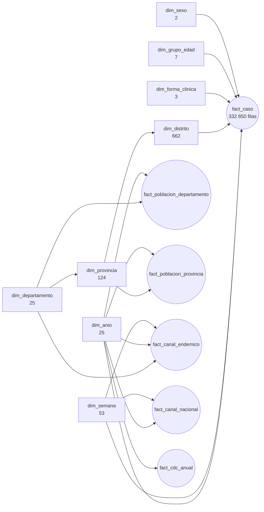

# Fase 4 — Modelado en Power BI

> Estado: **cerrada** (2026-10-13)

## 1. Resumen

El modelo de Power BI se guarda como **proyecto PBIP con TMDL**: tablas, consultas de Power Query,
relaciones y las 38 medidas DAX están en archivos de texto que se leen en GitHub. No se armó a mano:
lo genera [`tools/build_model.py`](../tools/build_model.py), así que es reproducible y cada cambio queda
en el historial.

**Las medidas se validaron contra Python.** En **9 702 comparaciones** (total, cada año, departamento,
provincia, forma clínica, grupo de edad, sexo, semana, año × departamento y año × semana) la diferencia
relativa máxima es de 4.9e-15, que es error de punto flotante. El texto de la fecha de corte también
coincide. El resultado completo está en [`reports/validacion_medidas.csv`](../reports/validacion_medidas.csv).

```bash
python tools/build_model.py                 # genera powerbi/dengue.SemanticModel
python tools/validate_measures.py consulta  # escribe tools/validacion_medidas.dax
powershell -File tools/refrescar.ps1 -Puerto <puerto de Desktop>      # refresca todo el modelo
powershell -File tools/ejecutar_dax.ps1 -Puerto <puerto> -Consulta tools/validacion_medidas.dax -Salida reports/medidas_dax.csv
python tools/validate_measures.py comparar reports/medidas_dax.csv
```

## 2. Modelo



- **18 relaciones** de muchos a uno, con filtro en un solo sentido: de la dimensión al hecho.
- **Territorio en cadena:** departamento → provincia → distrito → casos. No hay una relación directa entre
  departamento y distrito, porque con las dos el filtro llegaría al hecho por dos caminos y el modelo
  sería ambiguo. La cadena además permite filtrar por provincia sin perder el departamento.
- **Columnas técnicas ocultas:** claves, cantidades crudas y marcas de 0/1. Quien arma un visual ve
  medidas y atributos, no columnas que sumadas a mano darían resultados engañosos.
- **Sin medidas implícitas** (`discourageImplicitMeasures`): todo número sale de una medida.
- **El parámetro `RutaDatos`** apunta a `data/curated`. Al clonar el proyecto en otra ruta se cambia ahí y
  se actualiza.
- **Cultura `es-PE`** en el modelo y `en-US` al leer los CSV, porque pandas escribe el punto como separador
  decimal.

## 3. Las medidas

| Carpeta | Medida | Qué mide |
|---|---|---|
| Casos | `Casos` | Casos de dengue notificados al sistema de vigilancia, por lugar probable de infección. |
| Casos | `Casos año anterior` | Casos del año anterior al elegido. Solo con un año elegido. |
| Casos | `Var. interanual` | Variación de los casos frente al año anterior. Solo con un año elegido. |
| Casos | `% de los casos del país` | Parte de los casos del país (con el mismo año, forma clínica, edad y sexo) que tiene el territorio. |
| Casos | `Distritos con casos` | Distritos distintos con al menos un caso. |
| Casos | `Provincias con casos` | Provincias con al menos un caso. |
| Casos | `Departamentos con casos` | Departamentos con al menos un caso. |
| Casos | `Casos con edad válida` | Casos con una edad válida (hasta 110 años); sirven para la edad promedio. |
| Casos | `Edad promedio` | Edad promedio en años de los casos con edad válida. |
| Casos | `% de mujeres` | Parte de los casos que son mujeres. |
| Casos | `Participación del grupo de edad` | Parte de los casos que corresponde al grupo de edad dentro del contexto (año, territorio). |
| Gravedad | `Casos con signos de alarma o graves` | Casos clasificados como dengue con signos de alarma o dengue grave. |
| Gravedad | `% con signos de alarma o graves` | Parte de los casos con signos de alarma o graves. Solo comparable desde 2011: antes la clasificación era distinta. |
| Gravedad | `% con signos o graves (clasificación actual)` | Igual que % con signos de alarma o graves, pero vacío en los años anteriores a 2011, cuando la clasificación clínica era distinta. Úselo por año. |
| Gravedad | `Casos graves` | Casos de dengue grave. |
| Gravedad | `% graves` | Parte de los casos que son graves. |
| Gravedad | `Fallecidos (CDC)` | Fallecidos por dengue según la tabla oficial del CDC (2012–2024). El archivo de casos no los trae. |
| Gravedad | `Casos (CDC)` | Casos de la tabla oficial del CDC. |
| Gravedad | `Letalidad (CDC)` | Fallecidos entre casos, ambos de la tabla oficial del CDC. |
| Incidencia | `Población (habitantes-año)` | Población proyectada de los territorios elegidos, sumada sobre los años elegidos. Con un solo año es la población de ese año. Se calcula con el nivel que se muestra (provincia o departamento); un distrito no tiene población propia. |
| Incidencia | `Casos con población` | Casos de los años que tienen población (desde 2013 por departamento y desde 2016 por provincia). |
| Incidencia | `Incidencia por 100 mil` | Casos por 100 mil habitantes en un año. Sobre varios años es el promedio anual ponderado por población (suma de casos entre suma de población), nunca un promedio de tasas. Con edad o sexo elegidos, es la tasa de esos casos sobre la población total. |
| Incidencia | `Incidencia nacional` | La misma incidencia para todo el país, con el mismo periodo, forma clínica, edad y sexo. |
| Incidencia | `Veces la incidencia nacional` | Incidencia del territorio dividida por la nacional: 2 significa el doble. |
| Temporada | `Parte de los casos del año` | Parte de los casos del año (o periodo elegido) que cae en la semana. |
| Temporada | `Semana pico` | Semana epidemiológica con más casos en el contexto. |
| Temporada | `Casos en la semana pico` | Casos de la semana con más casos. |
| Canal endémico | `Semanas sobre el canal` | Semanas de departamento con más casos que el percentil 90 de las mismas semanas de los 5 años previos (y al menos 10 casos). |
| Canal endémico | `Semanas evaluadas` | Semanas de departamento evaluadas contra su canal (desde 2005). |
| Canal endémico | `% de semanas sobre el canal` | Parte de las semanas evaluadas que quedó sobre el canal. |
| Canal endémico | `Semanas del país sobre el canal` | Semanas en que los casos del país superaron el percentil 90 del canal nacional. |
| Canal endémico | `Umbral del canal (país)` | Percentil 90 de los casos del país en la misma semana de los 5 años previos. Úselo por semana y con un año elegido. |
| Canal endémico | `Mediana histórica (país)` | Mediana de los casos del país en la misma semana de los 5 años previos. |
| Canal endémico | `Umbral del canal (departamento)` | Percentil 90 de los casos del departamento en la misma semana de los 5 años previos. |
| Calidad de datos | `Casos sin edad válida` | Casos con edad imposible (más de 110 años), marcados en la Fase 2. |
| Calidad de datos | `Casos en distritos fuera del padrón` | Casos de distritos creados desde 2021 que el padrón de población no conoce: cuentan en la provincia, no tienen incidencia propia. |
| Textos | `Corte de datos` | Último año con datos. |
| Textos | `Fuente` | Pie de fuente para cada página. |

## 4. Cómo se calcula la incidencia por 100 mil

Los casos y la población son anuales, así que no hace falta anualizar: **casos del territorio entre su
población, por 100 000**. La medida resuelve tres cosas:

1. **El nivel que se muestra.** La población sale de la provincia si hay una provincia en el contexto
   (`dim_provincia[provincia_unica]` filtrada) y del departamento en cualquier otro caso, país incluido
   (suma de los 25). Un distrito no tiene población propia: devuelve vacío.
2. **Los años con población.** El numerador cuenta solo los casos de los años que tienen denominador: 2013 en
   adelante por departamento y 2016 en adelante por provincia. Sin esto, los casos de 2000–2012 inflarían la tasa.
3. **Varios años a la vez.** Es la suma de casos entre la suma de población: el promedio anual ponderado,
   nunca un promedio de tasas.

Si se filtra por edad, sexo o forma clínica, la medida divide esos casos entre la población **total**: la fuente
no trae población por sexo ni edad. Está dicho en la descripción de la medida.

## 5. Lo que se comprobó al validar

- **La validación cubre el total y los contextos cruzados**, no solo cada categoría: el error típico de DAX es
  una medida que da bien por año y mal en el total. Aquí se compararon además 3 304
  combinaciones de año × departamento y 4 176 de año × semana.
- **Una medida con territorio debe devolver lo mismo que Python en los 25 departamentos**, incluidos los que
  no tienen casos (Tacna, Huancavelica): ahí las sumas y los conteos dan 0 o vacío, y las razones, vacío.
- Las pruebas de `tests/test_powerbi.py` fijan tres cosas: ninguna variable DAX usa una palabra reservada
  (`top` deja la medida en error), el TMDL versionado es exactamente el que genera el script, y las
  9 702 comparaciones cumplen.
- **Refrescar un PBIP recién abierto** se hace con un solo comando ([`tools/refrescar.ps1`](../tools/refrescar.ps1)),
  que envía un refresco completo (TMSL) al modelo abierto. Antes eran 14 llamadas, una por tabla.

## 6. Lo que pasa a la Fase 5

El análisis de P1–P6 usa las mismas definiciones. Las cifras que aparecen en el tablero salen de
`reports/analisis/cifras_clave.csv`, calculado en Python con las reglas de este documento.
