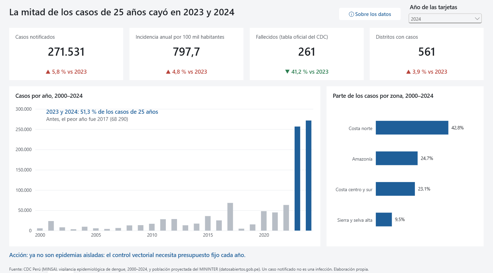
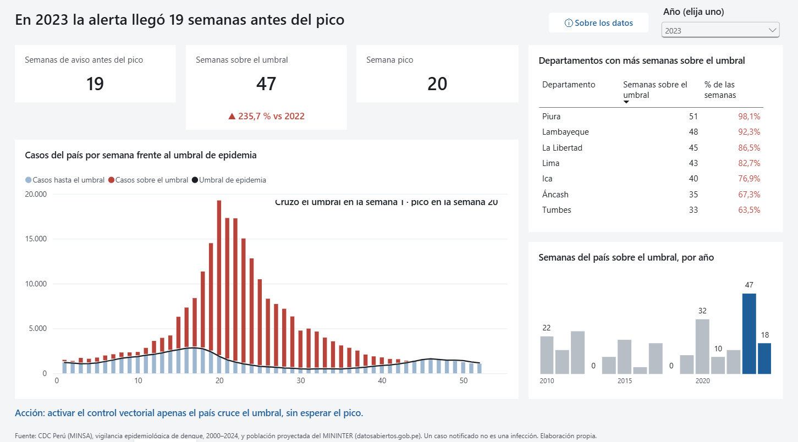
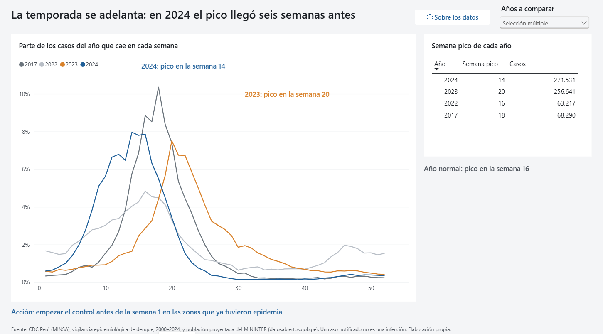
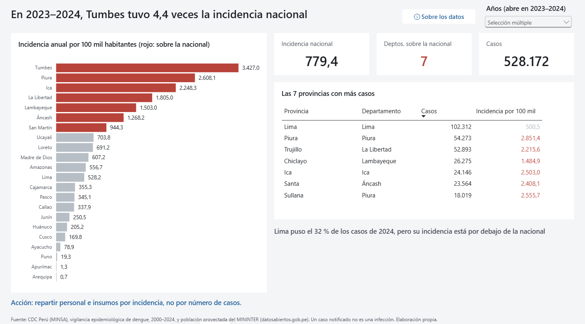
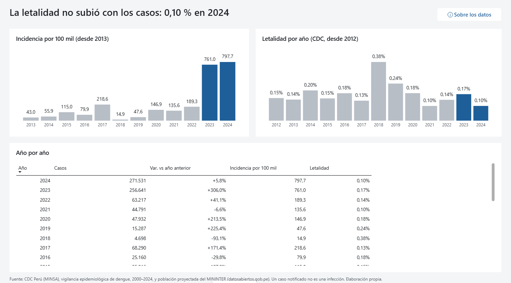
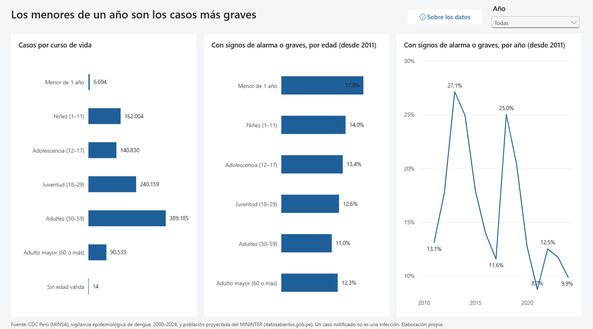
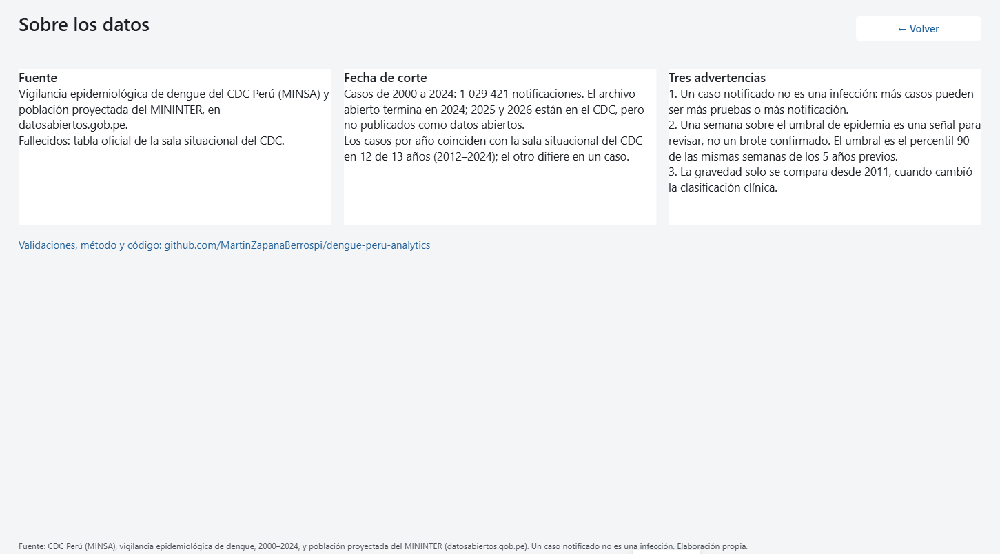

# Tablero de Power BI (PBIP)

> Fase 6 · Estado: **cerrada** (2026-10-13). **[Ver el tablero publicado](https://app.powerbi.com/view?r=eyJrIjoiNDRmNGU1YjctNTRjYi00MjM4LWI0MjYtYTRlY2I1NTljMDM5IiwidCI6IjFlYmE0NDNmLTIzZTUtNDUzNC05MGQxLTA5NzZhYWJlODZhYyIsImMiOjR9&pageName=p1_resumen)**

El informe se guarda como **Power BI Project**: el modelo en TMDL y el informe en PBIR (JSON), todo en
texto, revisable en GitHub sin abrir Power BI. **Ninguno de los dos se armó a mano.** Los generan dos
scripts, así que cada visual, medida y relación está en el historial de cambios:

```bash
python tools/build_model.py    # modelo: 14 tablas, 18 relaciones y 63 medidas DAX (38 de análisis y 25 de presentación)
python tools/build_report.py   # informe: 4 páginas de recorrido y 3 ocultas, 70 visuales, tema propio
```

## Cómo abrirlo

1. Clona el repositorio. Los datos que lee el tablero (`data/curated/*.csv`) vienen incluidos: no hace
   falta ejecutar el pipeline.
2. Abre `dengue.pbip` con **Power BI Desktop** (se construyó con la versión 2.157; necesita soporte para
   el formato de informe PBIR).
3. Si clonaste en otra carpeta: *Inicio → Transformar datos → Editar parámetros* y cambia **`RutaDatos`**
   por la ruta de tu copia de `data/curated/`, con la barra final.
4. *Inicio → Actualizar*. El repositorio no guarda la caché de datos (`.pbi/cache.abf`), así que el primer
   refresco es obligatorio. Carga 332 850 filas de casos en segundos.

## Páginas

El tablero se presenta en voz alta a gerencia, así que la pantalla lleva poco texto:
- **título:** la conclusión, en una línea (no la pregunta);
- **visuales:** la evidencia, con las anotaciones dentro del gráfico;
- **«Acción: …»:** una sola línea con lo que conviene decidir;
- **pie:** la fuente.

Lo que antes iba en recuadros de «Lectura» se dice al presentar; el guion está fuera del repositorio. Las cifras de los
títulos salen de [`reports/analisis/cifras_clave.csv`](../reports/analisis/cifras_clave.csv): ninguna se escribió a
mano.

**Recorrido (4 páginas, en el orden en que se presentan):**

| Página | Título (la conclusión) | Qué tiene |
|---|---|---|
|  **1. Resumen** | La mitad de los casos de 25 años cayó en 2023 y 2024 | 4 tarjetas (casos, incidencia, fallecidos, distritos) con su cambio frente al año anterior en rojo o verde; casos por año con 2023 y 2024 resaltados; parte de los casos por zona |
|  **2. Alerta temprana** (P6) | En 2023 la alerta llegó 19 semanas antes del pico | Casos del país por semana frente al **umbral de epidemia**, con el exceso en rojo; semanas de aviso; los 7 departamentos con más semanas sobre el umbral |
|  **3. Temporada** (P2) | La temporada se adelanta: en 2024 el pico llegó seis semanas antes | Parte de los casos del año en cada semana, para comparar años de distinto tamaño, y la semana pico de cada año |
|  **4. Territorio** (P3) | En 2023–2024, Tumbes tuvo 4,4 veces la incidencia nacional | Incidencia por departamento (en rojo, los que superan la nacional) y las 7 provincias con más casos |

**Páginas ocultas** (no salen en el recorrido; se abren desde el panel de páginas para responder preguntas):

| Página | Qué tiene |
|---|---|
|  **Detalle: año por año** (P1) | Incidencia y letalidad por año y la tabla año por año |
|  **Detalle: pacientes** (P4, P5) | Casos por curso de vida y parte con signos de alarma o graves, por edad y por año |
|  **Sobre los datos** | Fuente, fecha de corte y tres advertencias. Se llega con el botón **ⓘ Sobre los datos** de cada página y se vuelve con **← Volver** |

Las validaciones (V1–V4 y las 9 702 comparaciones de medidas) están en el [README principal](../README.md#cómo-se-construyó).

**Segmentadores.** Año en cada página del recorrido. En el resumen solo mueve las tarjetas (los gráficos muestran
siempre 2000–2024); la alerta temprana abre en 2023, la temporada en 2017, 2022, 2023 y 2024, y el territorio en
2023–2024.

## Decisiones de diseño

- **El título es la conclusión** y no hay recuadros de texto: el tablero se explica en voz alta. Las anotaciones van
  dentro del gráfico, las tarjetas comparan con el año anterior (rojo si sube, verde si baja) y el detalle técnico
  queda en los tooltips.
- **La alerta temprana va segunda.** El canal endémico es lo más útil para decidir: avisa semanas antes del pico. El
  exceso sobre el **umbral de epidemia** (percentil 90 de los 5 años previos) se pinta en rojo.
- **Tablas de 7 filas como máximo**, con barras de datos, filtradas por una medida de puesto (RANKX).
- **Incidencia con el denominador correcto.** La medida usa la población de la provincia o del departamento
  según lo que se muestre, cuenta solo los casos de los años que tienen población, y sobre varios años suma
  casos y población (nunca promedia tasas). Ver la [Fase 4](../docs/04_modelado.md#4-cómo-se-calcula-la-incidencia-por-100-mil).
- **La gravedad solo se compara desde 2011.** La clasificación clínica cambió: los gráficos de gravedad filtran
  los años anteriores, y una medida propia devuelve vacío antes de 2011.
- **Semanas y años en eje continuo.** Un eje de 53 categorías o de 25 años produce una barra de desplazamiento
  que esconde justo los años que más importan (2023 y 2024).
- **Números sin abreviar.** Power BI abrevia por defecto («256 mil»). Se desactivó en etiquetas, ejes y tarjetas.
- **Tema propio** ([`Dengue.json`](dengue.Report/StaticResources/RegisteredResources/Dengue.json)): un color de acento,
  fondo gris claro y tarjetas blancas, sin sombras ni bordes. Nada compite con los datos.

## Cómo se verificó

1. **Pruebas automáticas** ([`tests/test_powerbi.py`](../tests/test_powerbi.py)), en GitHub Actions:
   - ningún visual se sale del lienzo de 1280 × 720 ni se encima con otro;
   - cada medida y columna que usa un visual existe en el modelo;
   - cada página tiene título y pie;
   - el recorrido es de 4 páginas en el orden del guion, con títulos de 13 palabras o menos, botón ⓘ y sin
     recuadros de lectura; «Sobre los datos» está oculta;
   - los archivos versionados son exactamente los que producen los generadores.
2. **Medidas contra Python.** 9 702 comparaciones en Power BI Desktop, cero diferencias (ver la
   [Fase 4](../docs/04_modelado.md)).
3. **Revisión de cada captura a ojo** antes de cerrar la fase. Detectó lo que las pruebas no ven: gráficos con barra
   de desplazamiento que escondían 2023 y 2024, etiquetas de tarjeta de dos líneas que recortaban el valor, un grupo
   de edad con 14 casos que mostraba 21 % de gravedad y varias barras con decimales de más.

## Regenerar las capturas

```bash
powershell -File tools/refrescar.ps1 -Puerto <puerto de Desktop>      # el modelo recién abierto está vacío
powershell -ExecutionPolicy Bypass -File tools/capturas.ps1 -Salida <carpeta>   # busca el Desktop que abrió dengue.pbip
python tools/recortar_capturas.py <carpeta>
```

`capturas.ps1` cambia de página y captura la ventana de Power BI Desktop sin mover el mouse ni tomar el foco. Si
Desktop está minimizado, se restaura sin activarlo y se espera 20 s a que su árbol de accesibilidad aparezca.
